# Opskrifter

Doven comfort food. Hver opskrift giver **2 portioner** og tager **højst 8 min arbejdstid**.
Alt bygger på 5 baser, så én prepdag dækker en hel masse retter.

Udstyr: kombi-mikro med airfry, 1 pande, 1 gryde. Ingen ovn. Mikrotider er til 800 W. Airfryertider er med forvarmet kombi på airfryer-pladen (crisp-pladen), der fulgte med. Den hedder bare "pladen" herfra.
Kylling i retterne er **færdig vægt**: 1 kg rå kyllingebrystfilet giver ca. 700 g færdig kylling, 6 portioner à ca. 115 g (ca. 10 stykker).
1 krus = ca. 2,4 dl.

## Baser

### Base A: Sprød airfryer-kylling

Giver 6 portioner, ca. 700 g færdig kylling (af 1 kg rå).

- 1 kg rå kyllingebrystfilet (storpakning, frisk eller optøet)
- 1 terning hønsebouillon, smuldret
- ½ tsk salt
- ½ tsk sort peber
- 1 tsk hvidløgspulver
- 1 tsk paprika
- 3 spsk majsstivelse (Maizena)
- 1 tsk bagepulver
- 1 spsk olie, kommer i til sidst

1. Klip kyllingen i 3 cm stykker med en køkkensaks direkte ned i en stor skål. Intet skærebræt.
2. Smuldr bouillonen over. Salt, peber, hvidløg, paprika, majsstivelse og bagepulver i. Vend, til der ikke er mere tørt pulver.
3. Hæld olien i til sidst og vend igen.
4. Vask hænder, saks og alt, den rå kylling har rørt.
5. Airfry 200°C, forvarmet, hvis din model beder om det. En tredjedel af kyllingen pr. hold (ca. 350 g), ét lag på pladen med luft imellem. 15-18 min, vend halvvejs.
6. Skær det største stykke over efter 15 min. Hvidt hele vejen igennem (75°C) = færdig. Tag den ud, kyllingebrystfilet bliver hurtigt tør.
7. Færdig kylling i en ren skål, aldrig i den rå.

- **Køleskab:** 2-3 dage
- **Fryser:** 3 mdr. Frys den fladt i en pose, så stykkerne ikke fryser sammen.

> Majsstivelse + bagepulver er det sprøde trick, spring det ikke over. Kan der ligge 500 g fladt på din plade, så kør 2 hold i stedet for 3. Kyllingeoverlår virker også, de er saftigere og tørrer ikke så let ud.

### Base B: Krydret oksekød, 2 slags

Giver ca. 450 g tacokød + 600 g bolognese.

- 400 g hakket oksekød 8-12%
- 1 løg (groft hakket)
- 1 tsk salt
- 1 glas pastasauce (400 g), til bolognese
- 1 terning oksebouillon, til bolognese
- 1 tsk hvidløgspulver, til bolognese
- 1 tsk tørret oregano eller italienske krydderurter, til bolognese
- 1 brev tacokrydderi, til tacokødet
- 1 dåse kidneybønner, drænet, til tacokødet
- 1 spsk ketchup, til tacokødet
- 1 krus vand (halvdelen til hver)

1. Skær løget groft på en tallerken. Pænt behøver det ikke være, det smelter ind i kødet.
2. Pande på høj varme med lidt olie. Kød, løg og salt i. Del kødet med stegespaden og brun det i 8 min.
3. Læg halvdelen over i en af glasboksene. Den bliver til bolognese.
4. Resten i panden: tacokrydderi, bønner, ketchup og ½ krus vand. Mos bønnerne lidt, det gør det cremet. Lad det boble 4 min.
5. Tacokødet direkte i bokse. Så kommer det parkerede kød tilbage i panden.
6. Pastasauce, smuldret bouillon, hvidløg, oregano og ½ krus vand i. Simr 5 min. Det er bolognese.

- **Køleskab:** 2-3 dage
- **Fryser:** 3 mdr.

> Cheeseburgerkød (ret 10) er til en anden uge: brug det i stedet for taco- eller bolognese-halvdelen. Brun som normalt, og rør så 1 spsk ketchup + 1 tsk sennep i den halvdel. Giver ca. 200 g.

### Base C: En stor gryde ris

Giver 5 portioner, ca. 1 kg kogte ris.

- 2 krus jasminris (ca. 400 g)
- 2¾ krus vand (ca. 6,5 dl)
- ½ tsk salt

1. Skyl risen én gang i gryden. Hold låget på skrå og hæld vandet ud i vasken.
2. Vand og salt i, låg på, fuld varme, til det koger.
3. Laveste varme, 12 min. Løft ikke låget.
4. Fra varmen, låget bliver på, 8-10 min mere.
5. Fordel risen direkte i boksene, bred den ud og lad låget være af. Så køler den hurtigt. I køl eller frys inden for 1 time.

- **Køleskab:** 2 dage. Ris er den, du skal være streng med. Længere tid? Frys den.
- **Fryser:** 2 mdr.

> Varm kun ris op én gang, og til den damper. Genvej: mikroris i pose, 2 min ved 800 W. Dyrere, nul arbejde.

### Base D: Pasta

Giver 2 portioner.

- 2 krus penne (ca. 200 g tør vægt)
- 1 tsk salt

1. Fyld gryden halvt op med vand, salt i, låg på og bring i kog.
2. Kog 1 min KORTERE, end der står på pakken. Den bliver blødere, når du varmer op.
3. Hold låget på skrå og hæld vandet ud i vasken. Vend pastaen i sauce med det samme, så den ikke klistrer sammen.

- **Køleskab:** 2-3 dage (med sauce)
- **Fryser:** 3 mdr. (med sauce)

### Base E: Frosne kartoffelbåde

Giver 2 portioner.

- 500 g frosne kartoffelbåde

1. Prep dem aldrig. Lav dem direkte fra frost, når du skal spise. Det er nul arbejde alligevel.
2. Ét lag på pladen. Airfry 200°C, 20-25 min, vend 2 gange.

- **Køleskab:** Nej. Altid friske.
- **Fryser:** Det er der, de bor.

> Kombi-airfryere er svagere end kurvmodeller. Fyldt plade = bløde både. Mere end ca. 500 g? Så 2 omgange.

## Retterne

30 retter. Appen vælger en ny, varieret uge fra listen hver uge, og der kommer nye retter til hver fredag.

| # | Ret | Stil | Baser | Arbejdstid | Til |
|---|---|---|---|---|---|
| 1 | Burrito bowl med kylling | Mexicansk | A + C | 5 min | frokost (kun mikro) |
| 2 | Quesadillas med oksekød | Mexicansk | B | 8 min | aftensmad (airfryer) |
| 3 | Taco loaded fries | Mexicansk | B + E | 5 min | aftensmad (airfryer) |
| 4 | Butter chicken | Indisk | A + C | 3 min | frokost (kun mikro) |
| 5 | Koreansk sticky chicken | Koreansk | A + C | 4 min | frokost eller aftensmad |
| 6 | Pasta al forno | Italiensk | B + D | 5 min | frokost eller aftensmad |
| 7 | Cremet hvidløgspasta med kylling og parmesan | Italiensk | A + D | 6 min | frokost (kun mikro) |
| 8 | Sweet chili-kylling | Asiatisk takeaway | A + C | 6 min | frokost eller aftensmad |
| 9 | Buffalo chicken fries | Amerikansk diner | A + E | 5 min | aftensmad (airfryer) |
| 10 | Cheeseburger fries | Amerikansk diner | B + E | 5 min | aftensmad (airfryer) |
| 11 | Chili con carne med ris | Mexicansk | B + C | 4 min | frokost (kun mikro) |
| 12 | Enchiladas med oksekød og ost | Mexicansk | B | 7 min | frokost eller aftensmad |
| 13 | Loaded nachos med tacokød | Mexicansk | B | 5 min | aftensmad (airfryer) |
| 14 | Fajita bowl med kylling | Mexicansk | A + C | 4 min | frokost (kun mikro) |
| 15 | Sprøde chimichangas med kylling og bønner | Mexicansk | A | 8 min | aftensmad (airfryer) |
| 16 | Bulgogi-oksekød med ris | Koreansk | B + C | 4 min | frokost (kun mikro) |
| 17 | Cremet gochujang-pasta med kylling | Koreansk | A + D | 3 min | frokost (kun mikro) |
| 18 | Koreansk soy garlic chicken med både | Koreansk | A + E | 5 min | aftensmad (airfryer) |
| 19 | Chicken korma med ris og ærter | Indisk | A + C | 3 min | frokost (kun mikro) |
| 20 | Keema: indisk karrykød med ærter og ris | Indisk | B + C | 3 min | frokost (kun mikro) |
| 21 | Sprøde tikka-wraps med kylling og ost | Indisk | A | 7 min | aftensmad (airfryer) |
| 22 | Lasagne-pasta i glasboks | Italiensk | B + D | 5 min | frokost eller aftensmad |
| 23 | Pestopasta med kylling og ærter | Italiensk | A + D | 3 min | frokost (kun mikro) |
| 24 | Cremet tomatpasta med kylling | Italiensk | A + D | 3 min | frokost (kun mikro) |
| 25 | Cheeseburger mac and cheese | Amerikansk diner | B + D | 3 min | frokost eller aftensmad |
| 26 | Chicken tenders med både og honning-sennepsdip | Amerikansk diner | A + E | 4 min | aftensmad (airfryer) |
| 27 | Sloppy joe fries | Amerikansk diner | B + E | 5 min | aftensmad (airfryer) |
| 28 | Teriyaki-kylling med ris og broccoli | Asiatisk takeaway | A + C | 3 min | frokost (kun mikro) |
| 29 | Peanut chicken med ris og wokgrønt | Asiatisk takeaway | A + C | 3 min | frokost (kun mikro) |
| 30 | Fried rice med kylling og æg | Asiatisk takeaway | A + C | 3 min | frokost (kun mikro) |

### 1. Burrito bowl med kylling

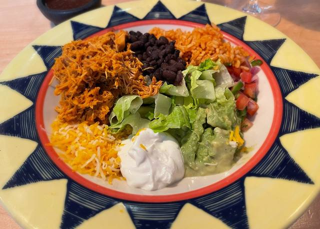

Foto: sarahstierch, CC BY 2.0 ([kilde](https://www.flickr.com/photos/7633518@N08/52033017109))

**Mexicansk** · Base A + C · 5 min arbejdstid · 2 portioner · frokost (kun mikro)

- 230 g færdig kylling (Base A, ca. 10 stykker pr. portion)
- ½ brev tacokrydderi
- 3 spsk vand
- 400 g kogte ris (Base C, ca. 1 krus pr. portion)
- ½ dåse majs, drænet
- 60 g revet ost (ca. 1 håndfuld pr. portion)
- 4 spsk salsa
- 4 spsk cremefraiche
- lime, knuste tortillachips eller ristede løg (valgfrit)

1. Pande, middel varme: kylling, tacokrydderi og vand. Vend 1-2 min, til krydderiet sidder fast.
2. På prepdagen: brug den uvaskede pande lige efter tacokødet. Gratis smag.
3. I boksen: ris, tacokylling, majs og ost ovenpå.
4. Salsa og cremefraiche bliver i køleskabet, til du skal spise.

- **Køleskab:** 2 dage (ris)
- **Fryser:** 2 mdr., uden salsa og cremefraiche
- **Opvarmning:** Mikro 800 W: 1 spsk vand på risen, låg på skrå, 3-4 min, rør halvvejs, til det damper. Kold salsa og cremefraiche på bagefter. Varmt og koldt sammen er hele pointen.
- **Når du spiser:** Kun mikro: 1 spsk vand på risen, låg på skrå, 3-4 min, rør halvvejs. Kold salsa og cremefraiche på bagefter. På uni: spring cremefraichen over.

> Et skvæt lime og en håndfuld knuste tortillachips = takeaway-niveau. Lyst til mere? Hurtigt syltede rødløg: tynde skiver, eddike over og en knivspids sukker og salt, 15 min. Holder en uge i køleskabet.

### 2. Quesadillas med oksekød

Foto: France1978, CC BY-SA 2.0 ([kilde](https://www.flickr.com/photos/51764518@N02/52527609055))

**Mexicansk** · Base B · 8 min arbejdstid · 2 portioner · aftensmad (airfryer)

- 6 tortillas (20 cm)
- 450 g tacokød (Base B)
- 120 g revet ost (ca. 2 håndfulde pr. portion)
- 1 tsk olie til ydersiden
- 4 spsk salsa til dip
- 4 spsk cremefraiche til dip
- syltede jalapeños (valgfrit)

1. Varm fyldet i mikroen under låg, 2 min, til det damper. Rør rundt.
2. Hver tortilla: ost på den ene halvdel, fyld, mere ost ovenpå, fold. Ost på begge sider limer den sammen.
3. Gnid ydersiden med lidt olie, bare med fingrene. Det giver den gyldne farve.
4. På pladen med folden nedad (eller en tandstik i). Airfry 200°C, 6-8 min, vend halvvejs. Der er plads til ca. 3 ad gangen.
5. Skær i trekanter og dip.

- **Køleskab:** Fyld 2-3 dage. Saml dem, når du skal spise, ca. 8 min.
- **Fryser:** Fyld 3 mdr. Tø det op i køleskabet natten over.
- **Opvarmning:** Mikro aldrig en færdig quesadilla, den bliver slap. Rester: airfryer 180°C, 3-4 min.
- **Når du spiser:** Fyldet i mikro 2 min, til det damper. 3 tortillas: ost, fyld, ost, fold, lidt olie udenpå. Airfryer 200°C 6-8 min, vend halvvejs.

### 3. Taco loaded fries

Foto: coolanimeboy25, CC BY 2.0 ([kilde](https://www.flickr.com/photos/198003881@N06/54005725008))

**Mexicansk** · Base B + E · 5 min arbejdstid · 2 portioner · aftensmad (airfryer)

- 500 g frosne kartoffelbåde (Base E, ca. ⅓ pose pr. portion)
- 450 g tacokød (Base B)
- 80 g revet ost
- 4 spsk salsa
- 4 spsk cremefraiche
- syltede jalapeños, lime, ristede løg (valgfrit)

1. Bådene i ét lag på pladen, 200°C, 20-25 min, vend 2 gange.
2. Tag pladen ud (bådene bliver på den). Kødet i mikroen under låg, 2-3 min, til det damper, rør halvvejs.
3. Kød og ost på bådene, pladen ind igen, 200°C, 2 min, til osten smelter.
4. Salsa, cremefraiche og jalapeños ovenpå.

- **Køleskab:** Kød 2-3 dage. Bådene laves altid friske.
- **Fryser:** Kød 3 mdr.
- **Opvarmning:** Ikke en opvarmningsret. Friske både er det, der holder det sprødt, og de er nul arbejde.
- **Når du spiser:** Bådene 200°C 20-25 min, vend 2 gange. Pladen ud, kødet i mikro 2-3 min. Kød og ost på bådene, 2 min i airfryeren.

### 4. Butter chicken

Foto: Bernard DUPONT, CC BY-SA 2.0 ([kilde](https://www.flickr.com/photos/65695019@N07/52894496300))

**Indisk** · Base A + C · 3 min arbejdstid · 2 portioner · frokost (kun mikro)

- 230 g færdig kylling (Base A, ca. 10 stykker pr. portion)
- 1 glas tikka masala- eller butter chicken-sauce (350 g)
- 400 g kogte ris (Base C, ca. 1 krus pr. portion)
- 150 g frosne ærter (ca. ½ krus pr. portion)
- en klat smør eller 1 spsk cremefraiche pr. boks, når du spiser (valgfrit)
- naan (valgfrit)

1. Kylling direkte i boksene ved siden af risen. Saucen over, rør rundt.
2. Frosne ærter ovenpå. De bliver kogt, når du varmer op.

- **Køleskab:** 2 dage (ris)
- **Fryser:** 3 mdr. Tåler frost bedre end de fleste.
- **Opvarmning:** Mikro 800 W: låg på skrå, 4-5 min, rør halvvejs, til det damper. Rør en klat smør eller cremefraiche i. Naan bagefter: airfryer 180°C, 2-3 min.
- **Når du spiser:** Kun mikro: låg på skrå, 4-5 min, rør halvvejs, til det damper. En klat smør eller cremefraiche i, hvis du er hjemme.

> Et glas tikka masala + en klat smør er stort set butter chicken. Rema har tikka-glasset billigst.

### 5. Koreansk sticky chicken

Foto: bryan..., CC BY-SA 2.0 ([kilde](https://www.flickr.com/photos/91049143@N00/51892695667))

**Koreansk** · Base A + C · 4 min arbejdstid · 2 portioner · frokost eller aftensmad

- 230 g færdig kylling (Base A, ca. 10 stykker pr. portion), uden sauce
- 2 spsk stærk chilisauce eller gochujang
- 1 spsk sojasauce
- 1 spsk honning
- 1 tsk hvidløgspulver
- 1 spsk vand
- 400 g kogte ris (Base C, ca. 1 krus pr. portion)
- 150 g frossen broccoli (ca. 2 håndfulde pr. portion)
- spicy mayo (mayo + chilisauce 3:1), forårsløg, sesam (valgfrit)

1. Rør chilisauce, soja, honning, hvidløg og vand sammen i et krus. Med chilisauce: ½ spsk ekstra honning i.
2. Fordel saucen i små bægre, ét pr. boks.
3. I boksen: ris, kylling uden sauce ovenpå, frossen broccoli. Saucebægeret ned i boksen.

- **Køleskab:** 2 dage (ris)
- **Fryser:** 2 mdr., med saucebæger og det hele
- **Opvarmning:** Sprød version (hjemme): tag saucebæger og kylling ud. Boksen i mikro med 1 spsk vand på risen, 4-5 min, rør halvvejs. Kyllingen 1 min i mikro, så på pladen ved 200°C i 3-4 min. Vend i saucen. Kun mikro: saucen over det hele, 1 spsk vand på risen, 4-5 min, rør halvvejs.
- **Når du spiser:** Kun mikro: saucen over det hele, 1 spsk vand på risen, låg på skrå, 4-5 min, rør halvvejs.
- **Hjemme til aftensmad:** Sprød version: tag saucebæger og kylling ud. Boksen i mikro 4-5 min. Kyllingen 1 min i mikro, så på pladen ved 200°C i 3-4 min. Vend i saucen.

> Gochujang er den ægte vare, men findes kun i Asian Market. Stærk chilisauce + lidt ekstra honning smager næsten lige så godt.

### 6. Pasta al forno

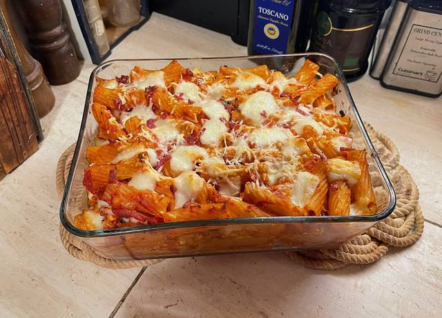

Foto: Key West Wedding Photography, CC BY 2.0 ([kilde](https://www.flickr.com/photos/58003213@N00/51414366873))

**Italiensk** · Base B + D · 5 min arbejdstid · 2 portioner · frokost eller aftensmad

- 200 g penne, tør vægt (ca. 1 krus pr. portion), kogt (Base D)
- 600 g bolognese (Base B)
- 100 g revet ost (ca. 2 håndfulde pr. portion)

1. Bland den afdryppede pasta med den varme bolognese.
2. Fordel i ovnfaste glasbokse. Ost ovenpå, ca. 2 håndfulde pr. boks.

- **Køleskab:** 2-3 dage
- **Fryser:** 3 mdr. Tø op i køleskabet natten over.
- **Opvarmning:** Mikro 800 W, låg på skrå, 3½-4 min, til det damper. Plastlåget AF, glasboksen i airfryeren, 200°C, 4-5 min, til osten bobler. Det er "ovn"-delen. Ingen tid? Kun mikro, stadig godt.
- **Når du spiser:** Kun mikro: låg på skrå, 3½-4 min, til det damper. Stadig godt.
- **Hjemme til aftensmad:** Mikro 3½-4 min, låg på skrå. Plastlåget af, glasboksen i airfryeren 200°C 4-5 min, til osten bobler.

### 7. Cremet hvidløgspasta med kylling og parmesan

Foto: MattCC716, CC BY-SA 2.0 ([kilde](https://www.flickr.com/photos/27874898@N00/51859685502))

**Italiensk** · Base A + D · 6 min arbejdstid · 2 portioner · frokost (kun mikro)

- 200 g penne, tør vægt (ca. 1 krus pr. portion), kogt (Base D)
- 230 g færdig kylling (Base A, ca. 10 stykker pr. portion)
- 150 g flødeost naturel
- 1,5 dl mælk
- 40 g revet parmesan (Grana Padano)
- 1 tsk hvidløgspulver
- 100 g frossen hakket spinat (ca. 2 klumper pr. portion)
- sort peber

1. Stor mikroskål: spinat under låg, 2 min.
2. Flødeost, mælk, hvidløg og parmesan i. 1½ min, rør, til det er glat.
3. Den varme pasta og kyllingen i. Masser af sort peber. I bokse.

- **Køleskab:** 2-3 dage
- **Fryser:** 1 md. Saucen kan skille lidt. Rør lidt mælk i, så samler den sig igen.
- **Opvarmning:** Et skvæt mælk (2 spsk) i først, flødesaucer bliver tykke i køleskabet. Mikro med låg på skrå 3 min, rør, 1 min mere, til det damper.
- **Når du spiser:** Kun mikro: et skvæt mælk (2 spsk) i, låg på skrå, 3 min, rør, 1 min mere.

### 8. Sweet chili-kylling

Foto: Dennis S. Hurd, CC BY 2.0 ([kilde](https://www.flickr.com/photos/43296902@N00/53435016125))

**Asiatisk takeaway** · Base A + C · 6 min arbejdstid · 2 portioner · frokost eller aftensmad

- 230 g færdig kylling (Base A, ca. 10 stykker pr. portion), uden sauce
- 90 ml sød chilisauce
- 2 spsk ketchup
- 1 spsk sojasauce
- 1 spsk eddike
- 250 g frosne wokgrøntsager (ca. ¼ pose pr. portion)
- 400 g kogte ris (Base C, ca. 1 krus pr. portion)
- lille dåse ananas i stykker, drænet (valgfrit)

1. Wokgrønt i en mikroskål under låg, 4-5 min. Hæld vandet fra.
2. Rør sød chili, ketchup, soja og eddike i (+ ananas). Det er saucen.
3. I boksen: ris og grønt i sauce. Kyllingen ovenpå uden sauce, så den kan blive sprød igen.

- **Køleskab:** 2 dage (ris)
- **Fryser:** 2 mdr.
- **Opvarmning:** Tag kyllingen ud. Boksen i mikro med 1 spsk vand på risen, låg på skrå, 4-5 min, rør halvvejs. Kyllingen 1 min i mikro, så på pladen ved 200°C i 3-4 min. Vend den i den varme sauce.
- **Når du spiser:** Kun mikro: 1 spsk vand på risen, låg på skrå, 4-5 min, rør halvvejs. Kyllingen er ikke sprød, men smagen er der.
- **Hjemme til aftensmad:** Tag kyllingen ud. Boksen i mikro 4-5 min. Kyllingen 1 min i mikro, så på pladen ved 200°C i 3-4 min. Vend i saucen.

> Du behøver ikke sursød sauce på glas: sød chili + ketchup + eddike er den klassiske takeaway-sauce, og den er billigere.

### 9. Buffalo chicken fries

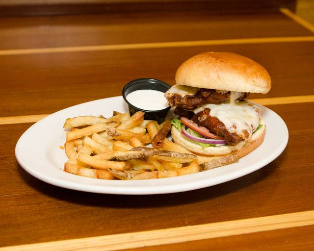

Foto: kurmanstaff, CC BY 2.0 ([kilde](https://www.flickr.com/photos/62558987@N07/51998656165))

**Amerikansk diner** · Base A + E · 5 min arbejdstid · 2 portioner · aftensmad (airfryer)

- 500 g frosne kartoffelbåde (Base E, ca. ⅓ pose pr. portion)
- 230 g færdig kylling (Base A, ca. 10 stykker pr. portion), uden sauce
- 3 spsk sriracha eller stærk chilisauce
- 2 spsk smør
- 1 spsk eddike
- 60 g revet ost (ca. 1 håndfuld pr. portion)
- 3 spsk hvidløgsdressing
- forårsløg eller ristede løg (valgfrit)

1. Smør, chilisauce og eddike i et krus. Mikro 30-40 sek., rør. Det er buffalosauce.
2. Bådene i ét lag på pladen, 200°C, 20-25 min, vend 2 gange. Kyllingen på pladen de sidste 6 min.
3. Vend kyllingen i saucen, tilbage på bådene, ost over, 1-2 min mere.
4. Hvidløgsdressing ovenpå.

- **Køleskab:** Kylling 2-3 dage. Bådene altid friske.
- **Fryser:** Kylling uden sauce 3 mdr., fladt i en pose. Tø op i køleskabet natten over.
- **Opvarmning:** Intet at varme op, alt laves frisk på ca. 30 min, heraf 5 min arbejdstid. Kyllingen skal dampe indeni. Ikke endnu? 2 min mere.
- **Når du spiser:** Krus: 1 spsk smør + 1½ spsk chilisauce + 1½ tsk eddike, mikro 30 sek. Bådene 200°C 20-25 min, kyllingen på de sidste 6. Vend i saucen, ost over, 1-2 min.

> Frank's RedHot er den amerikanske original, men svær at finde i Danmark. Chilisauce + smør + eddike kommer tæt på.

### 10. Cheeseburger fries

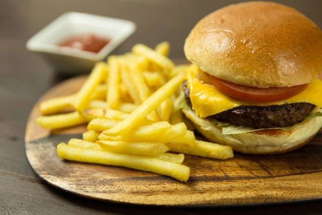

Foto: Unknown (via rawpixel), CC0 1.0 ([kilde](https://www.rawpixel.com/image/5970025/cheeseburger-fries-ketchup))

**Amerikansk diner** · Base B + E · 5 min arbejdstid · 2 portioner · aftensmad (airfryer)

- 500 g frosne kartoffelbåde (Base E, ca. ⅓ pose pr. portion)
- 200 g cheeseburgerkød (Base B, se note)
- 60 g revet ost (ca. 1 håndfuld pr. portion)
- 3 spsk burgerdressing
- 6 agurkeskiver, hakket
- ristede løg (valgfrit, meget burger)

1. Bådene i ét lag på pladen, 200°C, 20-25 min, vend 2 gange.
2. Tag pladen ud. Kødet i mikroen under låg, 2-3 min, til det damper.
3. Kød og ost over bådene, pladen ind igen, 200°C, 2 min, til osten smelter.
4. Dressing, agurker og ristede løg ovenpå. Drive-in-burger i en skål.

- **Køleskab:** Kød 2-3 dage. Bådene altid friske.
- **Fryser:** Kød 3 mdr.
- **Opvarmning:** Bådene laves friske. Kun kødet varmes op.
- **Når du spiser:** Bådene 200°C 20-25 min. Pladen ud, kødet i mikro 2-3 min. Kød og ost på bådene, 2 min i airfryeren.

### 11. Chili con carne med ris

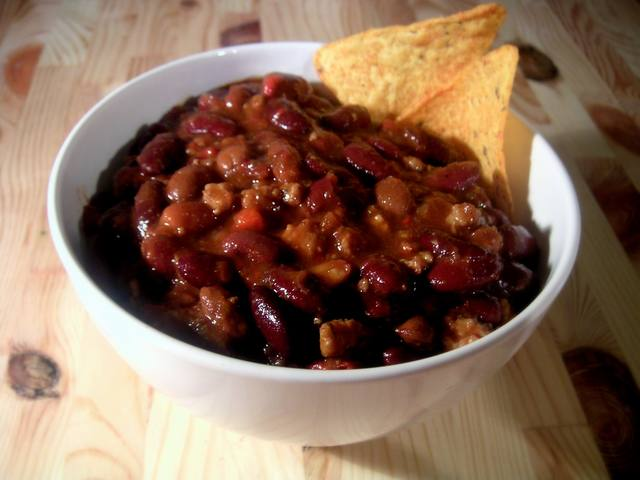

Foto: Carstor, CC BY-SA 2.5 ([kilde](https://commons.wikimedia.org/wiki/File:Bowl_of_chili.jpg))

**Mexicansk** · Base B + C · 4 min arbejdstid · 2 portioner · frokost (kun mikro)

- 300 g chili (Base B, chili-varianten)
- ½ brev tacokrydderi
- ½ dåse hakkede tomater
- ½ dåse kidneybønner, drænet
- 400 g kogte ris (Base C, ca. 1 krus pr. portion)
- 60 g revet ost
- 4 spsk cremefraiche
- knuste tortillachips (valgfrit)

1. Brun kødet sammen med resten af Base B. Kødet til chilien tilbage i panden.
2. Tacokrydderi, hakkede tomater, bønner og lidt vand i. Simr 6 min, til det er tykt.
3. I boksen: ris, chili ved siden af, lidt ost ovenpå.
4. Cremefraichen bliver i køleskabet, til du skal spise.

- **Køleskab:** 2 dage (ris)
- **Fryser:** 2 mdr.
- **Opvarmning:** Mikro 800 W: 1 spsk vand på risen, låg på skrå, 4-5 min, rør halvvejs, til det damper hele vejen igennem. En klat kold cremefraiche ovenpå.
- **Når du spiser:** Kun mikro: 1 spsk vand på risen, låg på skrå, 4-5 min, rør halvvejs. Cremefraiche på, hvis du har den med.

> Chili smager bedre dagen efter. En håndfuld knuste tortillachips ovenpå giver crunch.

### 12. Enchiladas med oksekød og ost

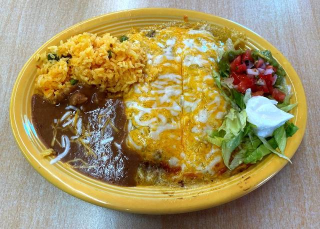

Foto: France1978, CC BY-SA 2.0 ([kilde](https://www.flickr.com/photos/51764518@N02/52272955976))

**Mexicansk** · Base B · 7 min arbejdstid · 2 portioner · frokost eller aftensmad

- 4 tortillas (20 cm)
- 300 g tacokød (Base B)
- 100 g revet ost (ca. 2 håndfulde pr. portion)
- 90 ml salsa
- 4 spsk cremefraiche
- syltede jalapeños (valgfrit)

1. Hver tortilla: lidt ost, en stribe tacokød, rul stramt.
2. Med samlingen nedad i den ovnfaste glasboks, 2 pr. boks.
3. Salsa over og en håndfuld ost ovenpå. Låg på, når det har dampet af.

- **Køleskab:** 2-3 dage
- **Fryser:** 2 mdr. Tø op i køleskabet natten over.
- **Opvarmning:** Mikro 800 W, låg på skrå, 4 min, til det damper i midten. Hjemme: plastlåget AF, glasboksen i airfryeren 200°C 4-5 min, til osten bobler. Sæt aldrig en frossen glasboks direkte ind på 200°C.
- **Når du spiser:** Kun mikro: låg på skrå, 4 min, til det damper i midten. Cremefraiche på.
- **Hjemme til aftensmad:** Mikro 3 min, låg på skrå. Plastlåget af, glasboksen i airfryeren 200°C 4-5 min, til osten bobler og kanterne bliver sprøde. Cremefraiche og jalapeños på.

> Tortillas der knækker, når du ruller? 10 sek i mikroen, så bliver de bløde.

### 13. Loaded nachos med tacokød

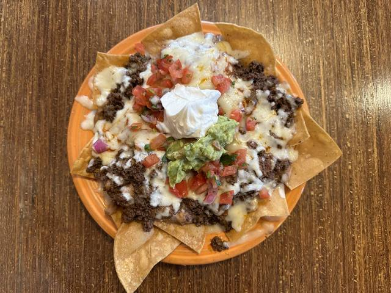

Foto: sarahstierch, CC BY 2.0 ([kilde](https://www.flickr.com/photos/7633518@N08/53677497745))

**Mexicansk** · Base B · 5 min arbejdstid · 2 portioner · aftensmad (airfryer)

- ¾ pose tortillachips (ca. 2 store håndfulde pr. portion)
- 300 g tacokød (Base B)
- 100 g revet ost
- 90 ml salsa
- 4 spsk cremefraiche
- syltede jalapeños, lime (valgfrit)

1. Kødet i mikroen under låg, 2-3 min, til det damper. Rør halvvejs.
2. Chips på pladen, gerne på bagepapir. Kød og ost over.
3. Airfryer 200°C, 3-4 min, til osten smelter. Hold øje, chips brænder hurtigt.
4. Salsa, cremefraiche og jalapeños ovenpå. Spis det fra pladen.

- **Køleskab:** Kød 2-3 dage.
- **Fryser:** Kød 3 mdr.
- **Opvarmning:** Ikke en opvarmningsret. Kun kødet varmes, chipsene skal være sprøde.
- **Når du spiser:** Kødet i mikro 2-3 min, til det damper. Chips på pladen, kød og ost over. Airfryer 200°C 3-4 min. Salsa og cremefraiche ovenpå.

> Bagepapir på pladen, så er opvasken næsten væk.

### 14. Fajita bowl med kylling

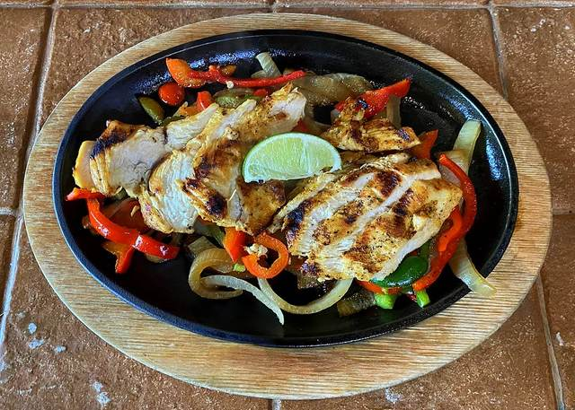

Foto: France1978, CC BY-SA 2.0 ([kilde](https://www.flickr.com/photos/51764518@N02/53697600292))

**Mexicansk** · Base A + C · 4 min arbejdstid · 2 portioner · frokost (kun mikro)

- 230 g færdig kylling (Base A, ca. 10 stykker pr. portion)
- ½ brev fajitakrydderi
- 250 g frosne wokgrøntsager (ca. ¼ pose pr. portion)
- 400 g kogte ris (Base C, ca. 1 krus pr. portion)
- 4 spsk salsa
- 4 spsk cremefraiche
- lime (valgfrit)

1. Pande, høj varme, lidt olie. Frosne wokgrøntsager i, steg 4 min, til vandet er væk.
2. Kylling, fajitakrydderi og et skvæt vand i. Vend 1-2 min, til krydderiet sidder fast.
3. I boksen: ris, kylling og grønt ovenpå.
4. Salsa og cremefraiche bliver i køleskabet, til du skal spise.

- **Køleskab:** 2 dage (ris)
- **Fryser:** 2 mdr., uden salsa og cremefraiche
- **Opvarmning:** Mikro 800 W: 1 spsk vand på risen, låg på skrå, 4 min, rør halvvejs, til det damper. Kold salsa og cremefraiche på bagefter.
- **Når du spiser:** Kun mikro: 1 spsk vand på risen, låg på skrå, 4 min, rør halvvejs. Salsa og cremefraiche på bagefter.

> Finder du frosne peberfrugtstrimler, så brug dem i stedet for wokgrønt. Endnu mere fajita.

### 15. Sprøde chimichangas med kylling og bønner

Foto: Nemeth/Star Productions, CC0 1.0 ([kilde](https://www.flickr.com/photos/192268789@N06/52778114660))

**Mexicansk** · Base A · 8 min arbejdstid · 2 portioner · aftensmad (airfryer)

- 230 g færdig kylling (Base A, ca. 10 stykker pr. portion)
- ½ brev fajitakrydderi
- ½ dåse kidneybønner, drænet
- 4 tortillas (20 cm)
- 100 g revet ost (ca. 2 håndfulde pr. portion)
- 1 tsk olie til ydersiden
- 90 ml salsa til dip
- 4 spsk cremefraiche til dip

1. Fyldet i mikroen under låg, 2 min, til det damper.
2. Hver tortilla: ost, fyld, mere ost. Fold siderne ind og rul stramt.
3. Gnid ydersiden med lidt olie. Samlingen nedad på pladen.
4. Airfry 200°C, 8 min, vend halvvejs, til de er gyldne og sprøde.
5. Dip i salsa og cremefraiche.

- **Køleskab:** Fyld 2-3 dage. Rul dem, når du skal spise.
- **Fryser:** Fyld 3 mdr. Tø op i køleskabet natten over.
- **Opvarmning:** Mikro aldrig en færdig chimichanga, den bliver slap. Rester: airfryer 180°C, 3-4 min.
- **Når du spiser:** Fyldet i mikro 2 min. 2 tortillas: ost, fyld, ost, fold siderne ind og rul. Lidt olie udenpå. Airfryer 200°C 8 min, vend halvvejs. Dip i salsa og cremefraiche.

> En chimichanga er en friturestegt burrito. Airfryeren gør det samme med en teskefuld olie.

### 16. Bulgogi-oksekød med ris

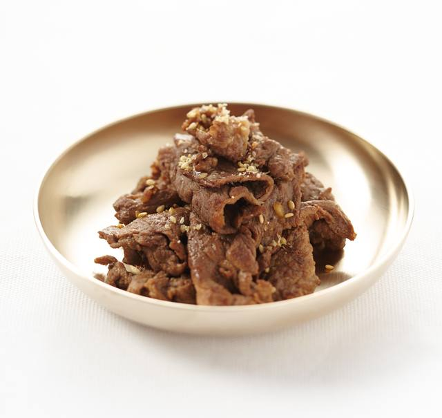

Foto: 국립국어원, CC BY-SA 2.0 kr ([kilde](https://commons.wikimedia.org/wiki/File:Bulgogi_2.jpg))

**Koreansk** · Base B + C · 4 min arbejdstid · 2 portioner · frokost (kun mikro)

- 250 g koreansk oksekød (Base B, bulgogi-varianten)
- 2 spsk sojasauce
- 2 spsk honning
- 1 tsk hvidløgspulver
- 2 tsk stærk chilisauce
- 400 g kogte ris (Base C, ca. 1 krus pr. portion)
- 200 g frossen broccoli (ca. 2 håndfulde pr. portion)
- sesam og forårsløg (valgfrit)

1. Brun kødet sammen med resten af Base B. Kødet til bulgogi tilbage i panden.
2. Soja, honning, hvidløg, chilisauce og lidt vand i. Lad det boble 3 min, til det er klistret og blankt.
3. I boksen: ris, kød ovenpå, frossen broccoli ved siden af. Den bliver kogt, når du varmer op.

- **Køleskab:** 2 dage (ris)
- **Fryser:** 2 mdr.
- **Opvarmning:** Mikro 800 W: 1 spsk vand på risen, låg på skrå, 4-5 min, rør halvvejs, til broccolien er varm og det damper.
- **Når du spiser:** Kun mikro: 1 spsk vand på risen, låg på skrå, 4-5 min, rør halvvejs. Sesam over, hvis du har.

> Ægte bulgogi er tynde skiver oksekød. Hakket kød er student-versionen, og den er lige så god.

### 17. Cremet gochujang-pasta med kylling

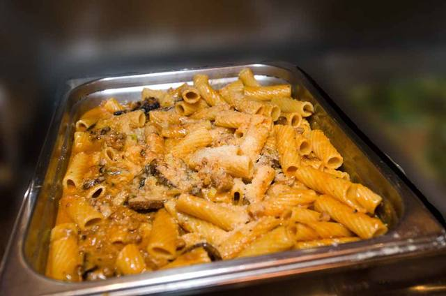

Foto: kurmanstaff, CC BY 2.0 ([kilde](https://www.flickr.com/photos/62558987@N07/52930710645))

**Koreansk** · Base A + D · 3 min arbejdstid · 2 portioner · frokost (kun mikro)

- 200 g penne, tør vægt (ca. 1 krus pr. portion), kogt (Base D)
- 230 g færdig kylling (Base A, ca. 10 stykker pr. portion)
- 100 g flødeost naturel
- 1,2 dl mælk
- 2 spsk stærk chilisauce eller gochujang
- 2 tsk sojasauce
- forårsløg (valgfrit)

1. Pande på lav varme: flødeost, mælk, chilisauce og soja. Rør, til det er glat og orange.
2. Den varme pasta og kyllingen i. Vend, til alt er dækket.
3. I bokse.

- **Køleskab:** 2-3 dage
- **Fryser:** 1 md. Saucen kan skille lidt. Rør et skvæt mælk i, så samler den sig igen.
- **Opvarmning:** Et skvæt mælk eller vand i først, flødesaucer bliver tykke i køleskabet. Mikro med låg på skrå 3 min, rør, 1 min mere, til det damper.
- **Når du spiser:** Kun mikro: et skvæt mælk eller vand i, låg på skrå, 3 min, rør, 1 min mere.

> Gochujang fra Asian Market giver den ægte smag. Chilisauce fra Netto virker fint.

### 18. Koreansk soy garlic chicken med både

Foto: KOREA.NET, CC BY-SA 2.0 ([kilde](https://commons.wikimedia.org/wiki/File:Iksan_City_48_Korean_Style_Fried_chicken.jpg))

**Koreansk** · Base A + E · 5 min arbejdstid · 2 portioner · aftensmad (airfryer)

- 500 g frosne kartoffelbåde (Base E, ca. ⅓ pose pr. portion)
- 230 g færdig kylling (Base A, ca. 10 stykker pr. portion), uden sauce
- 2 spsk sojasauce
- 2 spsk honning
- 1 tsk hvidløgspulver
- 2 tsk smør
- sesam og forårsløg (valgfrit)

1. Soja, honning, hvidløg og smør i et krus. Mikro 30-40 sek., rør. Det er glasuren.
2. Bådene i ét lag på pladen, 200°C, 20-25 min, vend 2 gange. Kyllingen på pladen de sidste 6 min.
3. Vend kyllingen i glasuren. Sesam og forårsløg over.

- **Køleskab:** Kylling 2-3 dage. Bådene altid friske.
- **Fryser:** Kylling uden sauce 3 mdr., fladt i en pose. Tø op i køleskabet natten over.
- **Opvarmning:** Intet at varme op, alt laves frisk på ca. 30 min, heraf 5 min arbejdstid. Kyllingen skal dampe indeni. Ikke endnu? 2 min mere.
- **Når du spiser:** Krus: 1 spsk soja, 1 spsk honning, ½ tsk hvidløgspulver, 1 tsk smør, mikro 30 sek. Bådene 200°C 20-25 min, kyllingen på de sidste 6. Vend kyllingen i glasuren.

> Lav glasuren i mikroen, før du tænder airfryeren. Kombien kan ikke begge dele på én gang.

### 19. Chicken korma med ris og ærter

Foto: France1978, CC BY 2.0 ([kilde](https://www.flickr.com/photos/51764518@N02/54378638535))

**Indisk** · Base A + C · 3 min arbejdstid · 2 portioner · frokost (kun mikro)

- 230 g færdig kylling (Base A, ca. 10 stykker pr. portion)
- ½ dåse kokosmælk
- 2 tsk karry
- 2 tsk honning
- ½ terning hønsebouillon
- 400 g kogte ris (Base C, ca. 1 krus pr. portion)
- 150 g frosne ærter (ca. ½ krus pr. portion)
- naan (valgfrit)

1. Pande, middel varme: kokosmælk, karry, honning og smuldret bouillon. Lad det boble 3 min, til det tykner lidt.
2. Kyllingen i, vend.
3. I boksen: ris, korma ved siden af, frosne ærter ovenpå. De bliver kogt, når du varmer op.

- **Køleskab:** 2 dage (ris)
- **Fryser:** 2 mdr.
- **Opvarmning:** Mikro 800 W: låg på skrå, 4-5 min, rør halvvejs, til det damper. Naan bagefter: airfryer 180°C, 2-3 min.
- **Når du spiser:** Kun mikro: låg på skrå, 4-5 min, rør halvvejs, til det damper.

> Korma er den milde, søde curry. Vil du have mere kick, så en skvæt chilisauce i.

### 20. Keema: indisk karrykød med ærter og ris

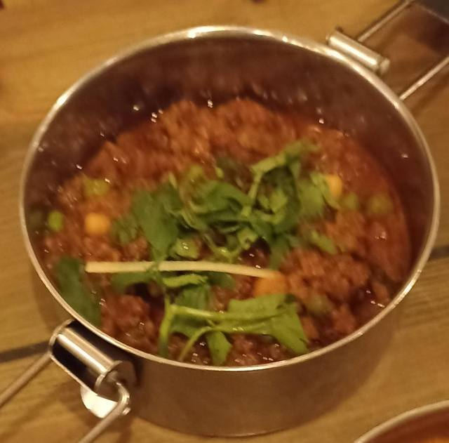

Foto: Haydn Blackey, CC BY-SA 2.0 ([kilde](https://www.flickr.com/photos/54549113@N00/52621574298))

**Indisk** · Base B + C · 3 min arbejdstid · 2 portioner · frokost (kun mikro)

- 300 g keema (Base B, keema-varianten)
- 2 tsk karry
- ½ dåse hakkede tomater
- 150 g frosne ærter (ca. ½ krus pr. portion)
- 400 g kogte ris (Base C, ca. 1 krus pr. portion)
- en klat cremefraiche, naan (valgfrit)

1. Brun kødet sammen med resten af Base B. Kødet til keema tilbage i panden.
2. Karry i, rør 30 sek., så dufter det. Hakkede tomater og frosne ærter i. Simr 5 min.
3. I boksen ved siden af risen.

- **Køleskab:** 2 dage (ris)
- **Fryser:** 2 mdr.
- **Opvarmning:** Mikro 800 W: 1 spsk vand på risen, låg på skrå, 4-5 min, rør halvvejs, til det damper. En klat cremefraiche på, hvis du er hjemme.
- **Når du spiser:** Kun mikro: 1 spsk vand på risen, låg på skrå, 4-5 min, rør halvvejs.

> Keema matar er indisk hverdagsmad. Ærterne er pointen, spar dem ikke.

### 21. Sprøde tikka-wraps med kylling og ost

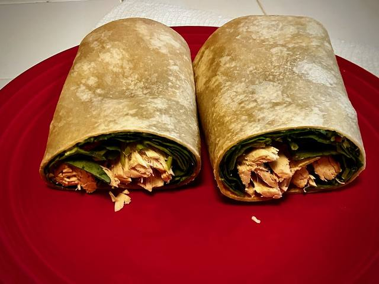

Foto: The Marmot, CC BY 2.0 ([kilde](https://www.flickr.com/photos/38142119@N00/53865511266))

**Indisk** · Base A · 7 min arbejdstid · 2 portioner · aftensmad (airfryer)

- 230 g færdig kylling (Base A, ca. 10 stykker pr. portion)
- ½ glas tikka masala-sauce
- 4 tortillas (20 cm)
- 80 g revet ost
- 1 tsk olie til ydersiden
- 4 spsk cremefraiche til dip

1. Kyllingen i mikroen under låg, 2 min, til den damper.
2. Hver tortilla: ost på den ene halvdel, tikkakylling, mere ost, fold.
3. Lidt olie udenpå. Airfry 200°C, 6-8 min, vend halvvejs.
4. Skær over og dip i cremefraiche.

- **Køleskab:** 2-3 dage
- **Fryser:** 3 mdr. Tø op i køleskabet natten over.
- **Opvarmning:** Mikro aldrig en færdig wrap, den bliver slap. Rester: airfryer 180°C, 3-4 min.
- **Når du spiser:** Kyllingen i mikro 2 min. 2 tortillas: ost, tikkakylling, ost, fold, lidt olie udenpå. Airfryer 200°C 6-8 min, vend halvvejs. Dip i cremefraiche.

> Samme glas tikka som butter chicken. Køb to, når du er i Rema.

### 22. Lasagne-pasta i glasboks

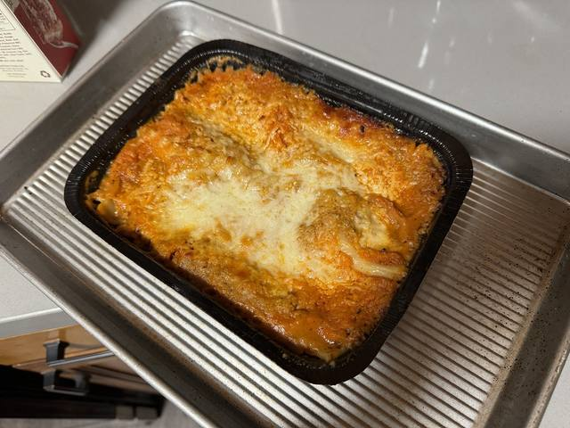

Foto: sarahstierch, CC BY 2.0 ([kilde](https://www.flickr.com/photos/7633518@N08/53394909015))

**Italiensk** · Base B + D · 5 min arbejdstid · 2 portioner · frokost eller aftensmad

- 200 g penne, tør vægt (ca. 1 krus pr. portion), kogt (Base D)
- 500 g bolognese (Base B)
- 80 g flødeost naturel
- 4 spsk mælk
- 100 g revet ost (ca. 2 håndfulde pr. portion)

1. Bland den afdryppede pasta med den varme bolognese.
2. Rør flødeost og mælk sammen i et krus. Det er den hvide sauce.
3. Glasboks: halvdelen af pastaen, klatter af den hvide sauce, resten af pastaen, ost ovenpå.

- **Køleskab:** 2-3 dage
- **Fryser:** 3 mdr. Tø op i køleskabet natten over.
- **Opvarmning:** Mikro 800 W, låg på skrå, 4 min, til det damper i midten. Hjemme: plastlåget AF, glasboksen i airfryeren 200°C 4-5 min, til osten bobler. Sæt aldrig en frossen glasboks direkte ind på 200°C.
- **Når du spiser:** Kun mikro: låg på skrå, 4 min, til det damper i midten.
- **Hjemme til aftensmad:** Mikro 3½ min, låg på skrå. Plastlåget af, glasboksen i airfryeren 200°C 4-5 min, til osten bobler.

> Al den lasagne-smag uden at lægge plader. Flødeosten er det, der gør det.

### 23. Pestopasta med kylling og ærter

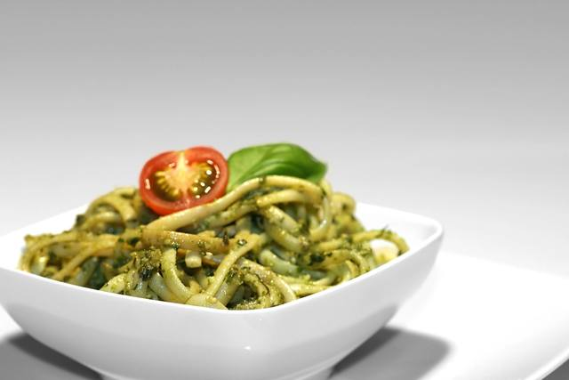

Foto: Unknown (via rawpixel), CC0 1.0 ([kilde](https://www.rawpixel.com/image/5969580/pesto-pasta))

**Italiensk** · Base A + D · 3 min arbejdstid · 2 portioner · frokost (kun mikro)

- 200 g penne, tør vægt (ca. 1 krus pr. portion), kogt (Base D)
- 230 g færdig kylling (Base A, ca. 10 stykker pr. portion)
- 80 g grøn pesto (ca. 4 spsk)
- 4 spsk cremefraiche
- 100 g frosne ærter
- revet parmesan (valgfrit)

1. Pesto og cremefraiche i den varme, afdryppede pasta. Rør rundt.
2. Kyllingen i, vend.
3. I bokse, frosne ærter ovenpå. De bliver kogt, når du varmer op.

- **Køleskab:** 2-3 dage
- **Fryser:** 2 mdr.
- **Opvarmning:** Mikro 800 W: 1 spsk vand i, låg på skrå, 3 min, rør, 1 min mere, til det damper. Parmesan over.
- **Når du spiser:** Kun mikro: 1 spsk vand i, låg på skrå, 3 min, rør, 1 min mere.

> Cremefraichen holder pestoen cremet, når du varmer op. Uden den bliver den olieret.

### 24. Cremet tomatpasta med kylling

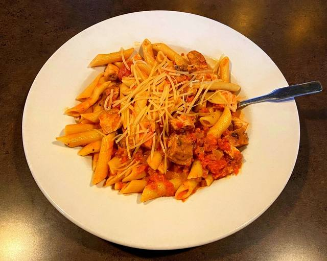

Foto: France1978, CC BY-SA 2.0 ([kilde](https://www.flickr.com/photos/51764518@N02/52381737651))

**Italiensk** · Base A + D · 3 min arbejdstid · 2 portioner · frokost (kun mikro)

- 200 g penne, tør vægt (ca. 1 krus pr. portion), kogt (Base D)
- 230 g færdig kylling (Base A, ca. 10 stykker pr. portion)
- ½ glas pastasauce (ca. 200 g)
- 80 g flødeost naturel
- ½ tsk oregano
- revet parmesan (valgfrit)

1. Pande, middel varme: pastasauce, flødeost og oregano. Rør, til det er glat og lyserødt.
2. Den varme pasta og kyllingen i. Vend.
3. I bokse.

- **Køleskab:** 2-3 dage
- **Fryser:** 2 mdr. Rør et skvæt vand i, hvis saucen skiller.
- **Opvarmning:** Et skvæt mælk eller vand i først. Mikro med låg på skrå 3 min, rør, 1 min mere, til det damper. Parmesan over.
- **Når du spiser:** Kun mikro: et skvæt vand i, låg på skrå, 3 min, rør, 1 min mere.

> Køber du det store glas pastasauce til bolognese, så tag lidt fra til den her.

### 25. Cheeseburger mac and cheese

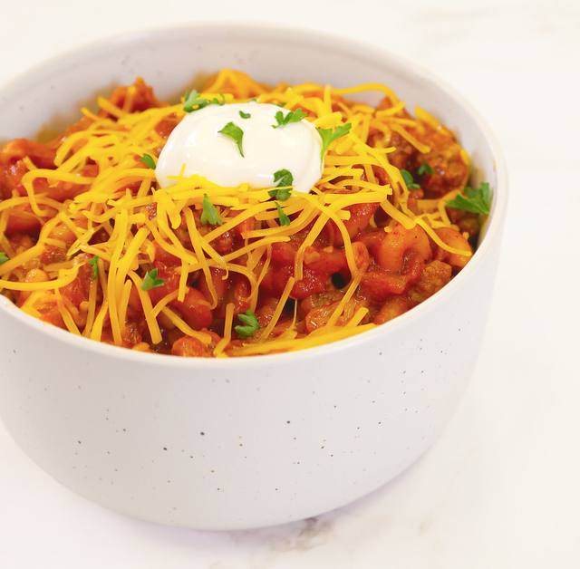

Foto: Alabama Extension, CC0 1.0 ([kilde](https://www.flickr.com/photos/184594136@N08/52287847559))

**Amerikansk diner** · Base B + D · 3 min arbejdstid · 2 portioner · frokost eller aftensmad

- 200 g penne, tør vægt (ca. 1 krus pr. portion), kogt (Base D)
- 250 g cheeseburgerkød (Base B)
- 1,5 dl mælk
- 60 g flødeost naturel
- 100 g revet ost (ca. 2 håndfulde)
- 6 agurkeskiver, hakket
- burgerdressing og ristede løg (valgfrit)

1. Afdryppet pasta tilbage i gryden, lav varme. Mælk, flødeost og ost i. Rør, til osten er smeltet.
2. Cheeseburgerkødet i, vend.
3. I bokse. Agurkerne bliver i glasset, til du skal spise.

- **Køleskab:** 2-3 dage
- **Fryser:** 2 mdr. Rør et skvæt mælk i, når du varmer op.
- **Opvarmning:** Ostesauce bliver tyk i køleskabet: 2 spsk mælk eller vand i først. Mikro med låg på skrå 3 min, rør, 1 min mere, til det damper. Hakkede agurker ovenpå.
- **Når du spiser:** Kun mikro: 2 spsk mælk eller vand i, låg på skrå, 3 min, rør, 1 min mere. Hakkede agurker ovenpå.
- **Hjemme til aftensmad:** Mikro som til frokost. Så agurker, burgerdressing og ristede løg ovenpå. Drive-in i en skål.

### 26. Chicken tenders med både og honning-sennepsdip

Foto: sarahstierch, CC0 1.0 ([kilde](https://www.flickr.com/photos/7633518@N08/54224925794))

**Amerikansk diner** · Base A + E · 4 min arbejdstid · 2 portioner · aftensmad (airfryer)

- 500 g frosne kartoffelbåde (Base E, ca. ⅓ pose pr. portion)
- 230 g færdig kylling (Base A, ca. 10 stykker pr. portion), uden sauce
- 4 spsk cremefraiche
- 2 tsk sennep
- 2 tsk honning
- ketchup (valgfrit)

1. Dip: cremefraiche, sennep og honning i et krus. Rør.
2. Bådene i ét lag på pladen, 200°C, 20-25 min, vend 2 gange. Kyllingen på pladen de sidste 6 min.
3. Dyp. Det er det hele.

- **Køleskab:** Kylling 2-3 dage. Bådene altid friske.
- **Fryser:** Kylling 3 mdr., fladt i en pose. Tø op i køleskabet natten over.
- **Opvarmning:** Intet at varme op, alt laves frisk på ca. 30 min, heraf 4 min arbejdstid. Kyllingen skal dampe indeni. Ikke endnu? 2 min mere.
- **Når du spiser:** Dip: 2 spsk cremefraiche, 1 tsk sennep, 1 tsk honning. Bådene 200°C 20-25 min, vend 2 gange, kyllingen på de sidste 6. Dyp.

> Base A er allerede nuggets. Det her er bare at give dem en dip og en kurv fritter.

### 27. Sloppy joe fries

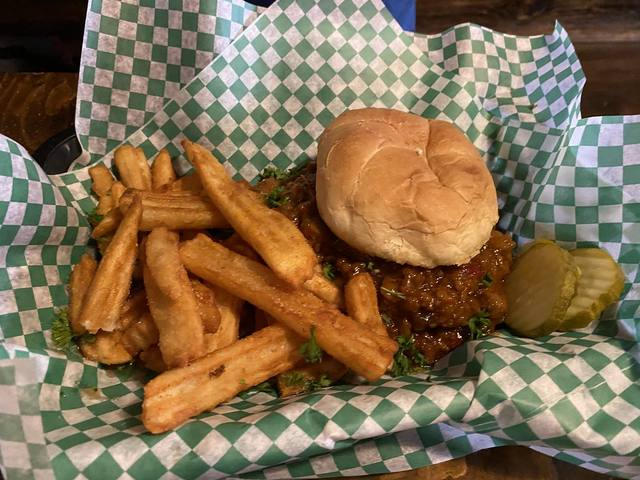

Foto: Compassionate Action for Animals, CC BY-SA 2.0 ([kilde](https://www.flickr.com/photos/29313544@N05/54527975620))

**Amerikansk diner** · Base B + E · 5 min arbejdstid · 2 portioner · aftensmad (airfryer)

- 500 g frosne kartoffelbåde (Base E, ca. ⅓ pose pr. portion)
- 280 g sloppy joe-kød (Base B, sloppy joe-varianten)
- 4 spsk ketchup
- 2 tsk sennep
- 2 tsk honning
- 1 tsk paprika
- 1 tsk eddike
- 80 g revet ost
- syltede agurker, ristede løg (valgfrit)

1. Brun kødet sammen med resten af Base B. Kødet til sloppy joe tilbage i panden.
2. Ketchup, sennep, honning, paprika, eddike og lidt vand i. Lad det boble 3 min, til det er tykt og sødt.
3. Når du skal spise: bådene i ét lag på pladen, 200°C, 20-25 min, vend 2 gange.
4. Pladen ud. Kødet i mikroen under låg, 2-3 min. Kød og ost på bådene, 2 min mere i airfryeren.

- **Køleskab:** Kød 2-3 dage. Bådene altid friske.
- **Fryser:** Kød 3 mdr.
- **Opvarmning:** Bådene laves friske. Kun kødet varmes op, til det damper.
- **Når du spiser:** Bådene 200°C 20-25 min, vend 2 gange. Pladen ud, kødet i mikro 2-3 min. Kød og ost på bådene, 2 min i airfryeren.

> Sloppy joe er en amerikansk skolekantine-klassiker. Normalt i en burgerbolle, her på fritter.

### 28. Teriyaki-kylling med ris og broccoli

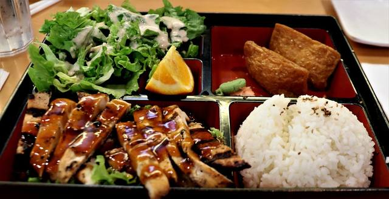

Foto: Thank You (23 Millions+) views, CC BY 2.0 ([kilde](https://www.flickr.com/photos/34128007@N04/52009317586))

**Asiatisk takeaway** · Base A + C · 3 min arbejdstid · 2 portioner · frokost (kun mikro)

- 230 g færdig kylling (Base A, ca. 10 stykker pr. portion)
- 3 spsk sojasauce
- 2 spsk honning
- 2 tsk eddike
- 1 tsk hvidløgspulver
- 1 tsk majsstivelse rørt ud i 6 spsk vand
- 400 g kogte ris (Base C, ca. 1 krus pr. portion)
- 200 g frossen broccoli (ca. 2 håndfulde pr. portion)
- sesam (valgfrit)

1. Rør majsstivelsen ud i vandet i et krus. Soja, honning, eddike og hvidløg i.
2. Pande, middel varme. Saucen i, bobl 1 min, til den er blank og tyk.
3. Kyllingen i, vend.
4. I boksen: ris, kylling ovenpå, frossen broccoli ved siden af.

- **Køleskab:** 2 dage (ris)
- **Fryser:** 2 mdr.
- **Opvarmning:** Mikro 800 W: 1 spsk vand på risen, låg på skrå, 4-5 min, rør halvvejs, til broccolien er varm og det damper.
- **Når du spiser:** Kun mikro: 1 spsk vand på risen, låg på skrå, 4-5 min, rør halvvejs. Sesam over, hvis du har.

> Teriyaki på flaske er dyr og sød. Soja + honning er 90% af den.

### 29. Peanut chicken med ris og wokgrønt

Foto: pelican, CC BY-SA 2.0 ([kilde](https://www.flickr.com/photos/85936780@N00/53853272250))

**Asiatisk takeaway** · Base A + C · 3 min arbejdstid · 2 portioner · frokost (kun mikro)

- 230 g færdig kylling (Base A, ca. 10 stykker pr. portion)
- 60 g peanutbutter (ca. 4 spsk)
- 2 spsk sojasauce
- 2 tsk honning
- 2 tsk stærk chilisauce
- 1,2 dl vand
- 400 g kogte ris (Base C, ca. 1 krus pr. portion)
- 250 g frosne wokgrøntsager (ca. ¼ pose pr. portion)
- lime (valgfrit)

1. Pande, lav varme: peanutbutter, soja, honning, chilisauce og vand. Rør, til det er glat.
2. Kyllingen i, vend.
3. I boksen: ris, kylling ovenpå, frosne wokgrøntsager ved siden af.

- **Køleskab:** 2 dage (ris)
- **Fryser:** 2 mdr.
- **Opvarmning:** Peanutsauce bliver tyk i køleskabet: 2 spsk vand i. Mikro 800 W, låg på skrå, 5 min, rør halvvejs, til grøntsagerne er varme og det damper.
- **Når du spiser:** Kun mikro: 2 spsk vand i, låg på skrå, 5 min, rør halvvejs. Et skvæt lime, hvis du har.

> Smager som satay fra takeaway. Crunchy peanutbutter giver ekstra bid.

### 30. Fried rice med kylling og æg

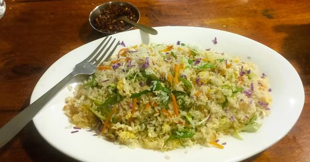

Foto: young shanahan, CC BY 2.0 ([kilde](https://www.flickr.com/photos/14759783@N04/54256818948))

**Asiatisk takeaway** · Base A + C · 3 min arbejdstid · 2 portioner · frokost (kun mikro)

- 230 g færdig kylling (Base A, ca. 10 stykker pr. portion)
- 400 g kogte ris (Base C, ca. 1 krus pr. portion)
- 2 æg
- 150 g frosne ærter (ca. ½ krus pr. portion)
- 2 spsk sojasauce
- forårsløg, chilisauce (valgfrit)

1. Pande, høj varme, lidt olie. Æggene i, rør rundt 1 min, til de er stivnet.
2. Ris, frosne ærter og soja i. Steg 4 min, vend tit, så risen får lidt stegeskorpe.
3. Kyllingen i, vend. I bokse, låg af, så det køler hurtigt.

- **Køleskab:** 2 dage (ris)
- **Fryser:** 1 md.
- **Opvarmning:** Mikro 800 W: 1 spsk vand på, låg på skrå, 3-4 min, rør halvvejs, til det damper hele vejen igennem. Ris varmes kun op én gang.
- **Når du spiser:** Kun mikro: 1 spsk vand på, låg på skrå, 3-4 min, rør halvvejs, til det damper.

> Takeaway-hemmeligheden er kold ris fra dagen før. Frisk ris virker også, bare steg den lidt længere.

## Opvarmningsregler

- Mikrotider er til 800 W. Ved 1000 W: træk ca. 20% fra.
- Varm op til det damper hele vejen igennem (75°C). I tvivl? 1 min mere. Rør halvvejs, mikroen varmer kanterne først.
- Ris: 1 spsk vand (eller en isterning) på inden mikro, låg på skrå. Varm kun ris op én gang.
- Mikrofunktion: mikroovnsegnede bokse, låg på skrå, ingen folie eller metal, og tag metalpladen ud.
- Airfryfunktion: kun ovnfast glas eller keramik, aldrig plastbokse eller plastlåg. Metal er fint.
- Sæt aldrig en frossen glasboks direkte ind på 200°C. Tø den op eller mikro den først.
- Sprødt: 1 min i mikro, så på pladen ved 200°C i 3-4 min. Kun mikro gør det slapt.
- Airfryertider er med forvarmet kombi. Forvarm, hvis din model beder om det. Den kan ikke mikro samtidig.
- Tø frosne bokse op i køleskabet natten over. Optøet: spis inden for 24 timer, frys aldrig igen. Glemt det? Optøning 4-5 min, så normal opvarmning.
